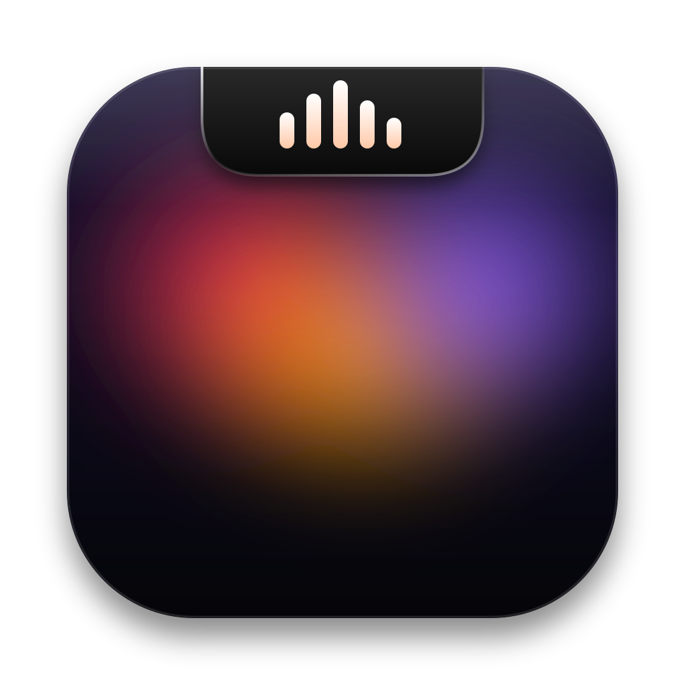

<p align="center">
  
</p>

<h1 align="center">Dynamic Island Music</h1>

<p align="center">
  Tu música, un Pomodoro con el tiempo que quieras, notas sincronizadas con iCloud, un chat con tu IA favorita y más, en el notch de tu Mac.<br>
  Gratis, de código abierto y sin telemetría.
</p>

## Instalar

### Mac: un comando y la app queda en tu escritorio

Pega esto en la app **Terminal** (macOS 14 o más nuevo; el Liquid Glass completo necesita macOS 26):

```bash
curl -fsSL https://raw.githubusercontent.com/OWNER/REPO/main/install.sh | bash -s -- OWNER/REPO
```

Descarga la última versión, comprueba su suma de verificación, la deja en tu **escritorio** y la abre. No usa `sudo` y **macOS no muestra ningún aviso**.
Si prefieres Aplicaciones, agrega `--applications` al final.

### Mac: compilarla tú desde el código (con Xcode)

```bash
git clone https://github.com/OWNER/REPO.git && cd REPO && ./build-mac.sh
```

Compila (unos 3 minutos la primera vez) y deja la app en el escritorio. Sirve aunque todavía no haya una versión publicada, y tampoco muestra avisos: la compilaste tú en tu Mac.

> **¿Por qué no es un `.dmg` de doble clic?** Apple solo quita el aviso a las apps firmadas con una cuenta de desarrollador de pago (US$99 al año) y este proyecto es gratuito.
> Los comandos de arriba evitan el aviso. Si bajas el `.dmg` desde el navegador, ve a *Ajustes del Sistema › Privacidad y seguridad › Abrir de todos modos*, solo la primera vez.
> Paso a paso y soluciones: [INSTALAR.md](INSTALAR.md).

### Windows: se instala como cualquier programa

Instalador de un clic: baja `DynamicIslandMusic-Setup.exe` desde [Releases](../../releases/latest) (si sale "Windows protegió tu PC": *Más información › Ejecutar de todas formas*). Queda en el menú Inicio, con desinstalador.

O con una línea en PowerShell (no pide administrador y SmartScreen no avisa):

```powershell
$env:DIM_REPO = 'OWNER/REPO'; irm https://raw.githubusercontent.com/OWNER/REPO/main/windows/install.ps1 | iex
```

También hay un `.zip` portátil (`DynamicIslandMusic-Windows-x64.zip`). Windows 10 u 11, 64 bits. Es una isla flotante arriba y al centro (Electron), con lo mismo que la de Mac. Guía de pruebas: [windows/PROBAR-EN-WINDOWS.md](windows/PROBAR-EN-WINDOWS.md).

## Qué trae

| | |
|---|---|
| **Reproductor** | Lee lo que suene en tu Mac: Spotify, Apple Music, YouTube en el navegador. Los colores del brillo salen de la carátula. |
| **Pomodoro** | Cualquier duración (`25`, `1:30`, `1:30:00`), sprints, sonido configurable al terminar, aviso y vista con el notch cerrado. |
| **Notas y tareas** | Un archivo `.md` por nota en la carpeta que elijas. En una carpeta de iCloud Drive se sincronizan solas con tu iPhone y tus otras computadoras. |
| **Chat de IA** | Claude, ChatGPT, Gemini u Ollama con tu propia clave (guardada en el Llavero). Sin servidor intermedio. |
| **Portapapeles** | Historial que ignora apps de contraseñas y datos secretos. |
| **Bandeja, Juego, Cámara, Calendario, Rendimiento** | Más componentes, todos opcionales. |
| **Todo editable** | Lápiz en el notch: arrastra para ordenar, tira de la esquina para cambiar el tamaño, quita y agrega. Si no caben, pasan a otra página. |
| **Se adapta a tu Mac** | Detecta el modelo y la pantalla (notch o sin notch) y ajusta el ancho. |
| **Liquid Glass** | Botones con el vidrio del sistema (macOS 26) y un brillo alrededor del notch con el color de la carátula. |

## Privacidad

Sin telemetría. Todo se guarda en tu equipo. Detalles en [SECURITY.md](SECURITY.md).

Sobre el chat de IA: cada persona usa su propia clave de API y paga solo lo que use. No se usa la suscripción de ChatGPT ni de Claude,
porque sus términos no lo permiten en apps de terceros.

## Compilar desde el código

**Windows:** `cd windows && npm ci && npm test && npm run dist` (en un Mac: `npm run dist:mac`, genera el instalador y el .zip sin Wine). La app se ve con `npm run start:mock` (música simulada).

**Mac:** necesitas Xcode 26 o más nuevo.

```bash
git clone https://github.com/OWNER/REPO.git
cd REPO
xcodebuild -project boringNotch.xcodeproj -scheme boringNotch -configuration Release \
  -derivedDataPath build -destination 'platform=macOS' \
  CODE_SIGN_IDENTITY="-" ENABLE_HARDENED_RUNTIME=NO DEVELOPMENT_TEAM="" CODE_SIGN_STYLE=Manual \
  -skipMacroValidation -skipPackagePluginValidation build
```

La app queda en `build/Build/Products/Release/Dynamic Island Music.app`. Para generar el `.dmg`: `scripts/make-dmg.sh`.
El código nuevo está en `boringNotch/islandmusic/`. El logo se regenera con `branding/make-icons.sh`.

## Licencia y créditos

GPL-3.0 (ver [LICENSE](LICENSE)). Basada en [Boring Notch](https://github.com/TheBoredTeam/boring.notch) de TheBoredTeam y colaboradores.
Más en [NOTICE.md](NOTICE.md). "Dynamic Island" es una marca de Apple Inc.; este proyecto no está afiliado a Apple.
